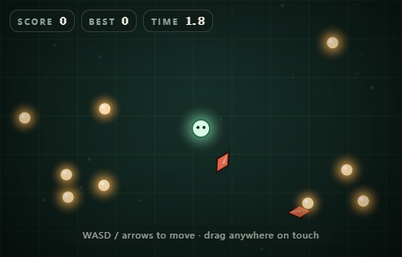
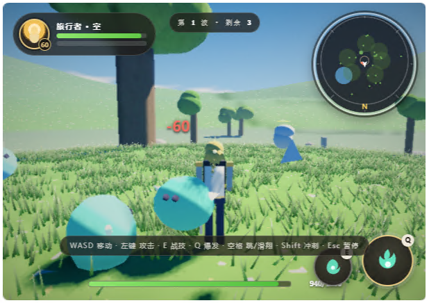
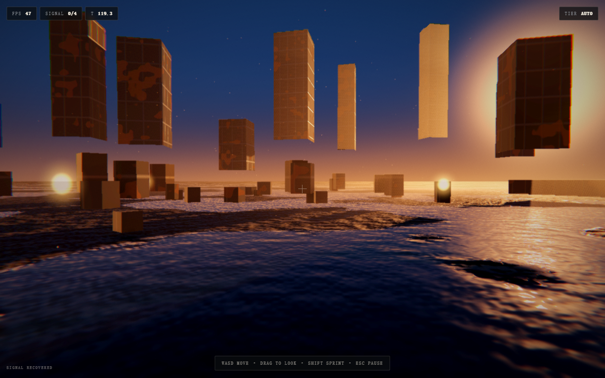

# Single-File Game

**ブラウザゲームを HTML ファイル 1 枚で、最後まで遊べる形に仕上げる。アセットなし、ビルドなし、実行時の通信なし。**

[](https://github.com/mollyneko/single-file-game/actions/workflows/validate.yml)
[](LICENSE)

[English](README.md) · [简体中文](README.zh-CN.md) · **日本語** · [한국어](README.ko.md)

---

## これは何か

**エージェントスキル**（標準の `SKILL.md` 形式。リファレンス、スクリプト、実行可能なテンプレートを
同梱）です。扱う対象はただ一つ——ゲームを**自己完結した HTML ファイル 1 枚**として出荷すること。

プレイヤーが見るもの・聞くものはすべて、ブラウザ内のコードがその場で生成します。絵は canvas か
シェーダで描き、音は WebAudio で合成し、マップやレベルはシードと表から組み立てます。ファイルは
ダブルクリックで開き、オフラインでも動き、CDN にもバンドラにも他人のサーバ稼働にも依存しません。

「ゲームの作り方」を解説するチュートリアルではありません。実際の単一ファイルゲームから抽出し、
本当に効く部分だけを残した**実行可能な手法**と、それを強制するツール群です。

| 2D テンプレート（生成直後） | 3D —— これで作ったゲーム |
| --- | --- |
|  |  |
| Canvas 2D · 28 KB · 収集・回避・スコア・保存 | WebGL2 · 140 KB · オープンフィールド、HDR、ソフトシャドウ、ボリューメトリック |

左は `assets/starter-2d.html` を生成したままの画面です。右は同じルールで作り込んだ完成品の
ゲームで、単一ファイル、地形もキャラクターも実行時に生成され、ディスク上にテクスチャはありません。
どちらも通信を切って `file://` から実行しており、フレーム内に画像ファイルは 1 枚もありません。

## 単一ファイルは「試作画質」の言い訳ではない

単一ファイルは制約であって、灰色の箱を出す理由ではありません。3D テンプレートは、小さな映画的
レンダラーを 1 つの `<script>` にゼロから書き切った参照実装です。

```
シャドウマップ → HDR シーン（PBR の空・地面・オブジェクト）→ ボリューメトリック光
              → SSAO ＋バイラテラルブラー → Bloom ピラミッド → ACES ＋グレーディング
              → sRGB エンコード → FXAA ＋粒子
```

得られるもの:

- **太陽 1 つ、空の関数 1 つ。** ドーム・環境光・フォグ・水たまりの映り込みが同じ `skyColor()`
  を呼ぶので、見えている地平線と水面の地平線が必ず一致します。
- **スケールのある表面。** 材質ごとに 5 チャンネル（アルベド、粗さ、金属度、高さ、AO）。プライマー
  → 錆の順の摩耗、オブジェクト空間の板継ぎ目、暗く・平らに・鏡面になる濡れマスク。
- **大気。** 半解像度レイマーチ、Henyey-Greenstein 位相関数、高さ密度、ステップごとの影参照。
  「3D」と「場所」の差はここです。
- **フィルターではなくグレーディング。** ACES、冷暖分離、ビネット、1.2% のグレイン。順番どおりに
  適用し、最後に一度だけエンコードします。

数値と失敗モードは [`references/cinematic-look.md`](references/cinematic-look.md) と
[`references/material-authoring.md`](references/material-authoring.md) にあります。

テンプレートは、自分のコードを 1 行も書く前からこの画面を出します:



## 四つのルール

どのルールも、失敗のカテゴリを一つ丸ごと消します。

| ルール | 意味 | 消える問題 |
| --- | --- | --- |
| **1 ファイル** | `<style>` 1 つ、`<script>` 1 つ。外部の `src`/`href` なし | ファイル欠落、CDN 障害 |
| **アセット 0** | 絵は描く、音は合成する、テクスチャは焼く | 404、ライセンス、素材未同梱 |
| **ビルドなし** | 素の ES をそのまま開く | ツールチェーンの陳腐化、「自分の環境では動く」 |
| **通信なし** | 実行時にリモートへの要求を一切しない | オフラインで死ぬ、プライバシーの懸念 |

## クイックスタート

```bash
git clone git@github.com:mollyneko/single-file-game.git
cd single-file-game

# 1. すでに遊べるゲームを生成（起動・プレイ・ポーズ・保存まで動作）
python scripts/scaffold.py --name "Orb Runner" --mode 2d --out orb-runner.html

# 2. GAME ブロックを差し替えて、監査する
python scripts/check_single_file.py orb-runner.html --strict

# 3. 開く — ダブルクリック、または:
open orb-runner.html        # macOS
start orb-runner.html       # Windows
xdg-open orb-runner.html    # Linux
```

`--mode 3d` で WebGL2 版になります。どちらのテンプレートも完成した「殻」です。デザイントークン、
起動画面、タイトル、HUD、ポーズとリザルトのカード、入力レイヤ、オーディオバス、セーブバス、
エラー境界、適応画質、そしてあなたのルールを書くための区切られたブロックが入っています。

## スキルとして導入

**Claude Code / プラグインマーケットプレイス**

```bash
/plugin marketplace add mollyneko/single-file-game
/plugin install single-file-game
```

**手動（`SKILL.md` を読めるエージェントなら何でも）**

```bash
git clone git@github.com:mollyneko/single-file-game.git
cp -r single-file-game ~/.claude/skills/single-file-game      # Claude Code
cp -r single-file-game ~/.workbuddy/skills/single-file-game   # WorkBuddy
```

リポジトリのルートがスキル本体です（`SKILL.md` + `references/` + `scripts/` + `assets/`）。

## 中身

```
single-file-game/
├── SKILL.md                    手法: ルール、手順、索引、アンチパターン
├── references/
│   ├── architecture.md         ファイル構成、シーン機構、ループ契約、リサイズと DPR
│   ├── procedural-art-2d.md    シード付きパレット、図形プリミティブ、タイル焼き込み、演出
│   ├── procedural-3d.md        WebGL2 構築、生成テクスチャ、グレーディング、画質ティア
│   ├── cinematic-look.md       レンダースタック：太陽、空、影、ボリューメトリック、Bloom、グレード
│   ├── material-authoring.md   PBR チャンネル、摩耗、継ぎ目、トライプラナー、水面、ベイク
│   ├── game-feel.md            ヒットストップ、揺れ、イージング、粒子、音の重ね、HUD モーション
│   ├── procedural-audio.md     SFX バス、ノイズ、ステップシーケンス音楽、ミックス
│   ├── input-and-mobile.md     単一の入力意図、タッチスティック、ポインタロック、セーフエリア
│   ├── state-and-persistence.md セーブ構造、バージョン、移行、自動保存
│   ├── performance.md          フレーム予算、焼き込み、プーリング、適応画質
│   ├── resilience-and-a11y.md  エラー境界、段階的縮退、視差効果の低減
│   ├── design-language.md      トークン、文字サイズ、ボタン、HUD 構成
│   └── release-checklist.md    出荷前チェックリスト
├── assets/
│   ├── starter-2d.html         実行可能な Canvas ゲームの殻
│   └── starter-3d.html         実行可能な WebGL2 ゲームの殻
├── scripts/
│   ├── scaffold.py             テンプレートから名前付きゲームを生成
│   └── check_single_file.py    規約に照らしてファイルを監査
├── docs/
│   └── method.md               なぜこの制約なのか、いつ使うべきでないか
└── tests/                      2 つのツールの単体テスト
```

## 7 ステップの手法

1. **1 文で範囲を決める。** ループ 1 つ、主要な動詞 1 つ、失敗状態 1 つ、再開手段 1 つ。
2. **先に殻を作る。** トークン → 起動 → タイトル → canvas → HUD → 画面群 → エラー境界。
3. **依存順にシステムを組む。** ループとリサイズが先、入力が次、ゲームプレイは最後。
4. **1 カットのように光を当てる。** 構図、キーライト 1 つ、摩耗のある材質、大気、そのあとにポスト処理。
   露出を触る前に sRGB エンコードを確認する。
5. **コンテンツはデータとして。** 手書きの実例ではなく、表とシード付き生成器。
6. **手触りは意図的に設計する。** 揺れ、粒子、ポップ、クリック音、待機モーション——安価で、すべて点検項目。
7. **監査して出す。** `check_single_file.py --strict`、その後にリリースチェックリスト。

論拠は [`docs/method.md`](docs/method.md)、実務的な詳細は [`SKILL.md`](SKILL.md) にあります。

## ツール

| コマンド | 役割 |
| --- | --- |
| `python scripts/scaffold.py --name "X" --mode 2d\|3d --out X.html` | テンプレートを複製し、タイトル・起動表示・保存名前空間・アクセント色を設定 |
| `python scripts/check_single_file.py X.html --strict` | リモート参照、通信呼び出し、欠けた殻、存在しない要素 ID、過大なサイズで失敗させる |
| `python -m unittest discover -s tests -v` | 監査器とスキャフォールドを良品／不良品で検証 |

このツール群の主役は監査器です。この形式が犯しがちなミスを狙い撃ちします。「とりあえず」足した
`<script src>`、消し忘れた `fetch`、HTML だけ直して JS に残った要素 ID、気づかぬうちに 3 MB に
膨らんだファイル。

```
FAIL  game.html  (1284.6 KB)
  x  <script src> found at line 12 — the file must work offline
  x  referenced but missing ids: hud-score, btn-retry
  !  no prefers-reduced-motion handling
```

## 使うべきでない場面

境界は正直に引きます。リアルタイム同期のマルチプレイ、手描きの大量アートや音楽ライブラリ、
長期的なチーム開発とファイル単位のレビュー、レベルごとのディープリンクや A/B テストが必要なら、
通常のビルドとアセットパイプラインを使ってください。

プロトタイプ、デモ、ゲームジャム、教材、社内ツール、小さなプロダクトでは、1 ファイルは妥協では
ありません。アイデアからプレイヤーまでの最短経路です。

## ライセンス

MIT © [mollyneko](https://github.com/mollyneko)
