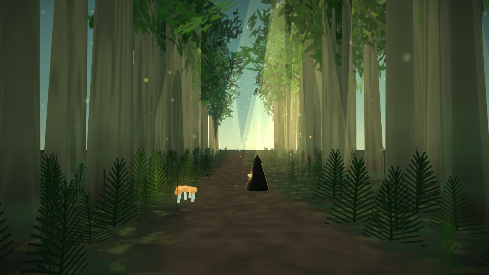
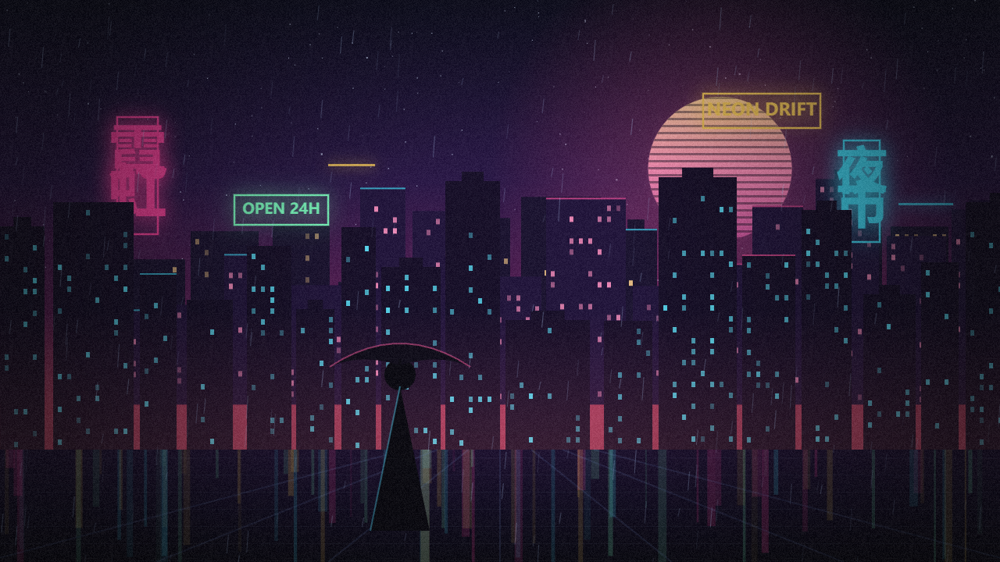

# Single-File Game — 単一ファイル HTML ゲーム

**最高の水準で単一ファイルのオフライン HTML ゲームを作る——three.js を骨格に、自作シェーダーで仕上げる——そして固定ルーブリックと決定的な撮影でその絵が耐えることを証明する。**

[](https://github.com/mollyneko/single-file-game/actions/workflows/validate.yml)
[](LICENSE)

[English](README.md) · [简体中文](README.zh-CN.md) · **日本語** · [한국어](README.ko.md)

<table>
<tr>
<td align="center" width="50%"><b>3D — three.js 骨格 + 自作 GLSL</b><br>
</td>
<td align="center" width="50%"><b>2D — プロシージャル canvas、レイヤー焼き込み</b><br>
</td>
</tr>
</table>

_代表フレーム：single-file の 3D シーン（three.js + 自作シェーダー）と 2D シーン（プロシージャル canvas）。証拠の単位は機能一覧ではなくフレームです。_

---

## 最優先の強制制約 — 以下すべてに優先する

> 充分发挥你最顶级的审美、艺术设计和3D编程能力，在构图、光影、材质、粒子、动画和空间氛围上做到极致。画面需要有令人震撼的视觉表现力。不限制你的创意和技术方案，尽可能展示你的能力上限。用three.js做骨架+自写着色器填充

「最高の審美眼、アートディレクション、3D プログラミング能力を総動員し、構図・光影・マテリアル・パーティクル・アニメーション・空間の雰囲気を極めよ。絵は心を撃つ視覚的冲击力を持たねばならない。創造的な解法と技術に上限は設けない。自分の上限を示せ。three.js を骨格とし、自作シェーダーで仕上げよ。」

これは第一条の制約であり、以下すべてに優先します。単一ファイルの境界は変わりません。**一つの `.html`、`file://` で開く、サーバーなし、ネットワークなし、外部アセットなし。** すべてインライン化してください。

## これは何か

単一ファイル HTML ゲームのための「制作 + 検証」Skill です。上記のビジュアル指令、優秀さを測定可能な条項に落とし込んだ九軸ルーブリック、二つのレビューを比較可能にする固定撮影プロトコル、そしてスクリプトが確認できる部分を調べるツールを提供します。証拠の単位は**フレーム**です——機能一覧でも、行数でも、5 点だらけの `SELF-REVIEW` でもありません。ソースは証拠になりません。ソースが正しくても、画面で手が肘から離れることはあります。

2.x で内蔵の制作経路（スキャフォールド、内蔵エンジン、開始テンプレート、アート／音声ガイド）を削除しました。残るのはこの指令、下の簡潔な制作順、そして検証体系です。ファイルをどう作るかはあなた次第です。

## 制作フロー — 指令をワークフローにする

六つの対象は最後に埋めるチェックリストではなく、制作順です。各工程は四つのプロトコルフレームのいずれかに写っていなければなりません。

0. **骨格とビジュアル命題を固定する。** 単一のインライン `.html`、最初の実行から `?shot=` / `?prewarm=` / `?q=` / `?seed=` を配線し、エラーバウンダリと DPR／リサイズ処理を入れる。焦点、パレット、光の向き、ムードを一文で書く。
1. **構図 / composition** — カメラを世界の中に置く。三つの奥行き層、一つの焦点、価値の序列。詳細の前に四ショットをフレーミングする。
2. **光影 / light & shadow** — 読みやすいキーライト一つ、実際の影、接触 AO／SSAO、深度フォグとボリューメトリック、統一したグレード。同じ太陽・フォグ・影データを自作シェーダーへ流す。
3. **マテリアル / material** — 名前付きマテリアル群と実行時生成マップ。既製マテリアルでは表せない見た目を自作 GLSL で担い、反射は空と一致させる。
4. **パーティクル / particles** — インスタンスまたは GPU 駆動で、光と空間の情報として使う。紙吹雪にしない。
5. **アニメーション / animation** — 接続されたリグまたはデフォーマーで待機・移動・命中を作る。イージング、ヒットストップ、シェイク、カメラ応答を入れ、動きフレームとクローズアップを確認する。
6. **空間の雰囲気 / spatial atmosphere** — プレート、デカール、デブリ、プレイ領域へ向かう密度勾配、視差、フォグ。ブルーム、グレイン、ビネット、グレードは最後に置く。
7. **システム → 検証ループ。** ゲームループを閉じ、入力／ポーズ／リスタートと耐障害を配線する。3D ではモデルごとに一つの `PIPELINE-RECEIPT` を保持。その後、下の六層ループを回す：撮影 → 採点 → 最悪の軸から修復 → 同じ四枚を再撮影。二ラウンドが最低です。

プロトコルフレームに写らない工程は、行われなかったものとして扱います。

## 六つの層 — 絵を検証する方法

| # | 層 | ツール | 失敗条件 |
| --- | --- | --- | --- |
| 1 | フォーマット | `check_single_file.py … --strict` | 外部参照、ネットワーク呼び出し、id 欠落、`<title>`/viewport 欠落、エラーバウンダリなし |
| 2 | クラフト（3D のみ） | 同じ実行に `--craft` | インライン `three.js` なし、不正な `PIPELINE-RECEIPT`、裸のプリミティブ、RGB のみのパレット、テクスチャなし、スキニングなし |
| 3 | ハード制約（3D のみ） | 同じ実行と画面確認 | SSAO なし、深度認識ボリューメトリックなし、ドラッグしないと視点が動かない、自審記録なし |
| 4 | フレーム指標 | `score_frame.py capture` + `--craft` | manifest／指紋不一致、一视图を四枚と偽る、フレームが設定した cap を超える点数 |
| 5 | 九軸 | `references/scoring-rubric.md` | 4 点未満の軸、六軸のうち達線が五つ未満、切断された肢体 |
| 6 | 出荷チェック | `references/release-checklist.md` | スクリプトが見えない起動・入力・ゲームプレイ・耐障害・アクセシビリティ・内容・配布の欠陥 |

最初の五つは修復ループへの入力です。撮影 → 採点 → 最悪の軸を直す → 再撮影 → 再採点。第 4 層は媒体を問いません。2D キャンバスも WebGL と同じように黒潰れ・白飛び・色落ちします。第 2–3 層は 2D には存在しませんが、評価は存在します。

## クイックスタート

```bash
# 1. 機械ゲート。--mode は容量予算だけを選ぶ；ゲート集合はビルドから判定される。
python scripts/check_single_file.py game.html --strict --craft --mode auto

# 2. 固定撮影：四ショット、1280x720 @1、200 フレームのウォームアップ、high、seed 0。
python scripts/score_frame.py capture game.html --out review/round-1
python scripts/score_frame.py score review/round-1/manifest.json
python scripts/score_frame.py capture game.html --out review/round-2 --marker

# 3. references/scoring-rubric.md に照らして九軸を書面で採点し、
#    最優先制約に向けて直し、同じフレームを再撮影し、release-checklist.md を歩く。
```

ビルドは `?shot=title|play|char-closeup|hero-effect`、`?prewarm=`、`?q=`、`?seed=` に応答する必要があります。四枚が同じ絵なら撮影は拒否され、判定は**検証不能**です。ソースから点数を推測しないでください。`score_frame.py crop shot.png out.png --box x,y,w,h --scale 3` は観察用の補助であり、プロトコルフレームではありません。ヘッドレス Chrome、Edge、または `chrome-headless-shell` が必要です（`--chrome PATH` / `CHROME_PATH` で指定可）。

## 採点

六つの出荷軸——空間、光、マテリアル、反射、世界ディテール、予算——が「AAA に見えるか」を決め、三つのレビュー軸——美しさ、構造的妥当性、UI 可読性——が「見ていられるか」を決めます。各軸は 1–5 点、**4 点が出荷ライン**。六軸のうち達線が五つ未満ならプロトタイプです。2D はルーブリックの翻訳表で同じ九軸を読みます。閾値は変わりません。ピクセル指標は点数を下げることしかできず、cap を超える軸には軸名・実測値・様式的理由を記した `overrides` が必要です。

`SELF-REVIEW` HTML コメントは、点数をそのフレームに結び付ける領収書です：

```html
<!-- SELF-REVIEW {"rounds":2,
  "shots":["title","play","char-closeup","hero-effect"],
  "axes":{"space":5,"light":4,"material":5,"reflection":4,"world":4,"budget":4,
          "beauty":4,"structure":5,"ui":5},
  "fixes":["rig: parent-relative bone offsets","added depth-based SSAO"],
  "reshoot":true,
  "metrics":{"manifest":"review/round-2/manifest.json","sha256":"<manifest sha256>"}} -->
```

監査は manifest のハッシュ、ビルド指紋、≥3 フレーム、複数ビュー、cap を検査します。数字そのものは判定しません。マーカーは領収書であり、レビューではありません。

## ファイル

| パス | 担当 |
| --- | --- |
| `SKILL.md` | 制作指令 + 検証の入口：最優先制約、六面の制作フロー、六層、プロトコル、判定手順、結論の形式 |
| `references/scoring-rubric.md` | 九軸・1–5 段階・下限・2D 翻訳表・赤線の唯一の定義 |
| `references/visual-self-review.md` | 撮影 → 採点 → 修復 → 再撮影、肢体チェック、症状 → 原因 |
| `references/release-checklist.md` | 最終の手動ウォーク |
| `scripts/score_frame.py` | 撮影、ピクセル指標、cap、クロップ |
| `scripts/check_single_file.py` | フォーマット・クラフト・ハード制約・フレーム指標のゲート |
| `docs/` | ヒーロー画像：`game-3d.png`（three.js + 自作シェーダー）と `game-2d.png`（プロシージャル canvas） |
| `tests/` | 回帰テスト（fixture はすべてインライン） |

```bash
python -m unittest discover -s tests -v
```

## ライセンス

MIT。[LICENSE](LICENSE) を参照。
