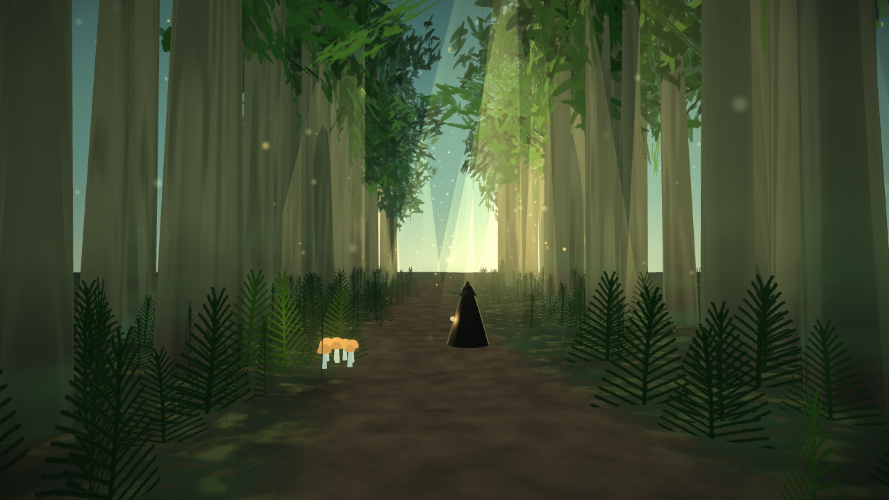
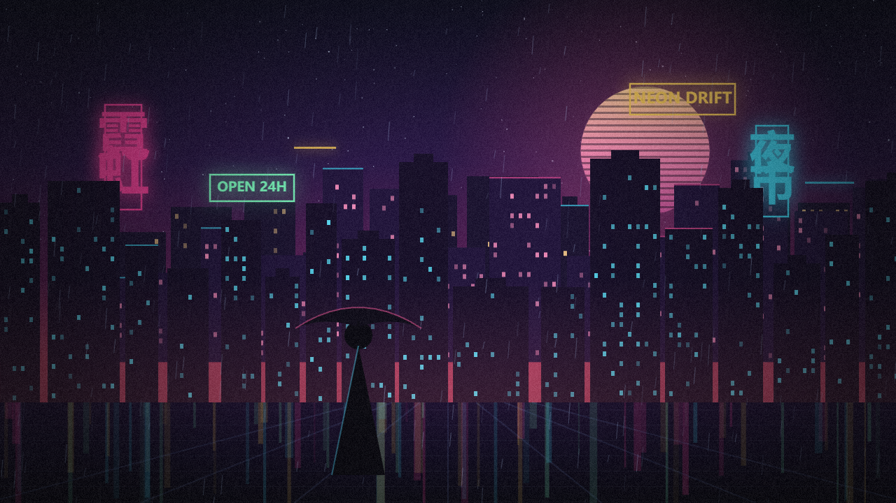

# Single-File Game — 단일 파일 HTML 게임

**최고의 수준으로 단일 파일 오프라인 HTML 게임을 만든다 — three.js를 골격으로, 직접 작성한 셰이더로 완성한다 — 그런 다음 고정 루브릭과 결정론적 캡처로 그 화면이 견디는지 증명한다.**

[](https://github.com/mollyneko/single-file-game/actions/workflows/validate.yml)
[](LICENSE)

[English](README.md) · [简体中文](README.zh-CN.md) · [日本語](README.ja.md) · **한국어**

<table>
<tr>
<td align="center" width="50%"><b>3D — 최신 three.js + 자작 GLSL</b><br>
</td>
<td align="center" width="50%"><b>2D — 절차적 canvas, 레이어 베이크</b><br>
</td>
</tr>
</table>

_대표 프레임: 최신 인라인 three.js + 자작 셰이더로 그린 아침 숲과 절차적 canvas 야경. 증거의 단위는 기능 목록이 아니라 프레임입니다._

---

## 최우선 강제 제약 — 아래 모든 항목보다 우선한다

> 充分发挥你最顶级的审美、艺术设计和3D编程能力，在构图、光影、材质、粒子、动画和空间氛围上做到极致。画面需要有令人震撼的视觉表现力。不限制你的创意和技术方案，尽可能展示你的能力上限。用three.js做骨架+自写着色器填充

"최고의 심미안, 아트 디렉션, 3D 프로그래밍 능력을 총동원해 구도·광영·머티리얼·파티클·애니메이션·공간의 분위기를 극한까지 끌어올려라. 화면은 압도적인 시각적 임팩트를 가져야 한다. 창의적 해법과 기술에 제한을 두지 말고, 네 능력의 한계를 보여라. three.js를 골격으로 쓰고 직접 작성한 셰이더로 채워라."

이것이 첫 번째 제약이며 아래 모든 항목보다 우선합니다. 단일 파일 경계는 그대로입니다. **하나의 `.html`, `file://`로 열기, 서버 없음, 네트워크 없음, 외부 애셋 없음.** 모든 것을 인라인으로 집어넣으세요.

## 무엇인가

단일 파일 HTML 게임을 위한 "제작 + 검증" Skill입니다. 위의 비주얼 지시, 우수함을 측정 가능한 조항으로 옮긴 9축 루브릭, 두 평가를 비교 가능하게 만드는 고정 캡처 프로토콜, 그리고 스크립트가 확인할 수 있는 부분을 검사하는 도구를 제공합니다. 증거의 단위는 **프레임**입니다 — 기능 목록도, 줄 수도, 5점으로 가득한 `SELF-REVIEW`도 아닙니다. 소스는 증거가 아닙니다. 소스가 올바라도 화면에서는 손이 팔에서 떨어질 수 있습니다.

2.x에서 내장 제 경로(스캐폴드, 내장 엔진, 시작 템플릿, 아트/오디오 가이드)를 제거했습니다. 남은 것은 이 지시, 아래의 간결한 제작 순서, 그리고 검증 체계입니다. 파일을 어떻게 만드는지는 당신의 몫입니다.

## 제작 흐름 — 지시를 워크플로로 바꾸기

여섯 대상은 마지막에 채우는 체크리스트가 아니라 제작 순서입니다. 각 단계는 네 프로토콜 프레임 중 하나에 보여야 합니다.

0. **골격과 비주얼 명제 고정.** 단일 인라인 `.html`, 첫 실행부터 `?shot=` / `?prewarm=` / `?q=` / `?seed=` 연결, 오류 경계와 DPR/리사이즈 처리. 초점, 팔레트, 빛 방향, 무드를 한 문장으로 적는다.
1. **구도 / composition** — 카메라를 세계 안에 둔다. 세 깊이 층, 하나의 초점, 가치 위계. 디테일 전에 네 샷을 프레이밍한다.
2. **광영 / light & shadow** — 읽히는 키 라이트 하나, 실제 그림자, 접촉 AO/SSAO, 깊이 안개와 볼류메트릭, 통일된 그레이드. 같은 태양·안개·그림자 데이터를 자작 셰이더로 흘린다.
3. **머티리얼 / material** — 이름 있는 머티리얼 계열과 런타임 생성 맵. 기성 머티리얼이 표현하지 못하는 부분은 자작 GLSL이 맡고, 반사는 하늘과 일치해야 한다.
4. **파티클 / particles** — 인스턴스 또는 GPU 구동으로 빛과 공간의 정보로 쓴다. 색종이 조각이 되면 안 된다.
5. **애니메이션 / animation** — 연결된 리그 또는 디포머로 대기·이동·피격을 만든다. 이징, 히트스톱, 셰이크, 카메라 반응을 넣고 움직이는 프레임과 클로즈업을 확인한다.
6. **공간의 분위기 / spatial atmosphere** — 플레이트, 데칼, 파편, 플레이 영역으로 갈수록 밀도가 오르는 구배, 시차, 안개. 블룸, 그레인, 비네트, 그레이드는 마지막에 둔다.
7. **시스템 → 검증 루프.** 게임 루프를 닫고 입력·일시정지·재시작과 내구성을 연결한다. 3D라면 모델마다 `PIPELINE-RECEIPT` 하나를 유지한다. 그다음 아래의 여섯 계층 루프를 돈다: 캡처 → 채점 → 최악 축부터 수리 → 같은 네 장 재촬영. 두 라운드가 최소다.

프로토콜 프레임에 보이지 않는 단계는 수행되지 않은 것으로 간주합니다.

## 여섯 계층 — 화면을 검증하는 방법

| # | 계층 | 도구 | 실패 조건 |
| --- | --- | --- | --- |
| 1 | 형식 | `check_single_file.py … --strict` | 외부 참조, 네트워크 호출, 누락된 id, `<title>`/viewport 누락, 오류 경계 없음 |
| 2 | 공예(3D만) | 같은 실행에 `--craft` | 인라인 `three.js` 없음, 잘못된 `PIPELINE-RECEIPT`, 날것 프리미티브, RGB 전용 팔레트, 텍스처 없음, 스키닝 없음 |
| 3 | 하드 제약(3D만) | 같은 실행 + 화면 확인 | SSAO 없음, 깊이 인식 볼류메트릭 없음, 드래그해야 시점이 움직임, 자기 검토 기록 없음 |
| 4 | 프레임 지표 | `score_frame.py capture` + `--craft` | manifest/지문 불일치, 한 화면을 네 장으로 속임, 프레임이 정한 cap을 넘는 점수 |
| 5 | 9축 | `references/scoring-rubric.md` | 4점 미만 축, 6개 출하 축 중 5개 미만 달성, 끊어진 팔다리 |
| 6 | 출하 체크리스트 | `references/release-checklist.md` | 스크립트가 못 보는 부팅·입력·게임플레이·내구성·접근성·콘텐츠·전달 결함 |

처음 다섯 계층은 수리 루프로 들어가는 입력입니다. 캡처 → 채점 → 최악의 축 수리 → 재촬영 → 재채점. 4계층은 매체를 가리지 않습니다. 2D 캔버스도 WebGL과 똑같이 암부 뭉개짐·과노출·색 바램이 발생합니다. 2~3계층은 2D에 없지만 점수는 있습니다.

## 빠른 시작

```bash
# 1. 머신 게이트. --mode는 크기 예산만 고른다; 게이트 집합은 빌드가 결정한다.
python scripts/check_single_file.py game.html --strict --craft --mode auto

# 2. 고정 캡처: 네 샷, 1280x720 @1, 200프레임 워밍업, high, seed 0.
python scripts/score_frame.py capture game.html --out review/round-1
python scripts/score_frame.py score review/round-1/manifest.json
python scripts/score_frame.py capture game.html --out review/round-2 --marker

# 3. references/scoring-rubric.md에 따라 9축을 글으로 채점하고,
#    최우선 제약을 향해 고치고 같은 프레임을 다시 찍은 뒤 release-checklist.md를 따른다.
```

빌드는 `?shot=title|play|char-closeup|hero-effect`, `?prewarm=`, `?q=`, `?seed=`에 응답해야 합니다. 네 장이 같은 그림이면 캡처는 거부되고 판정은 **검증 불가**입니다. 소스에서 점수를 추측하지 마세요. `score_frame.py crop shot.png out.png --box x,y,w,h --scale 3`은 관찰용 보조이며 프로토콜 프레임이 아닙니다. 헤드리스 Chrome, Edge 또는 `chrome-headless-shell`이 필요합니다(`--chrome PATH` / `CHROME_PATH`로 지정 가능).

## 채점

여섯 출하 축——공간, 빛, 머티리얼, 반사, 세계 디테일, 예산——이 AAA처럼 보이는지를 정하고, 세 검토 축——미학, 구조적 타당성, UI 가독성——이 볼 만한지를 정합니다. 각 축은 1~5점, **4점이 출하선**입니다. 여섯 축 중 다섯 개 미만이 통과하면 프로토타입입니다. 2D는 루브릭의 변환표로 같은 아홉 이름을 읽으며 기준은 그대로입니다. 픽셀 지표는 점수를 낮추기만 하고, cap을 넘긴 축에는 축 이름·실측값·양식적 이유가 담긴 `overrides`가 필요합니다.

`SELF-REVIEW` HTML 주석은 점수를 프레임에 묶는 영수증입니다:

```html
<!-- SELF-REVIEW {"rounds":2,
  "shots":["title","play","char-closeup","hero-effect"],
  "axes":{"space":5,"light":4,"material":5,"reflection":4,"world":4,"budget":4,
          "beauty":4,"structure":5,"ui":5},
  "fixes":["rig: parent-relative bone offsets","added depth-based SSAO"],
  "reshoot":true,
  "metrics":{"manifest":"review/round-2/manifest.json","sha256":"<manifest sha256>"}} -->
```

감사기는 manifest 해시, 빌드 지문, 3개 이상 프레임, 둘 이상의 뷰, cap을 검사합니다. 숫자 자체는 판정하지 않습니다. 마커는 영수증이지 리뷰가 아닙니다.

## 파일

| 경로 | 역할 |
| --- | --- |
| `SKILL.md` | 제작 지시 + 검증 진입점: 최우선 제약, 여섯 면 제작 흐름, 여섯 계층, 프로토콜, 판정 절차, 결론 형식 |
| `references/scoring-rubric.md` | 9축·1~5단계·하한·2D 변환표·레드라인의 유일한 정의 |
| `references/visual-self-review.md` | 캡처 → 채점 → 수리 → 재촬영, 관절 체크리스트, 증상 → 원인 |
| `references/release-checklist.md` | 최종 수동 점검 |
| `scripts/score_frame.py` | 캡처, 픽셀 지표, cap, 크롭 |
| `scripts/check_single_file.py` | 형식·공예·하드 제약·프레임 지표 게이트 |
| `docs/` | 히어로 이미지: `game-3d.png`(숲, 최신 three.js + 자작 셰이더) 및 `game-2d.png`(절차적 canvas) |
| `tests/` | 회귀 테스트(fixture는 모두 인라인) |

```bash
python -m unittest discover -s tests -v
```

## 라이선스

MIT. [LICENSE](LICENSE) 참조.
