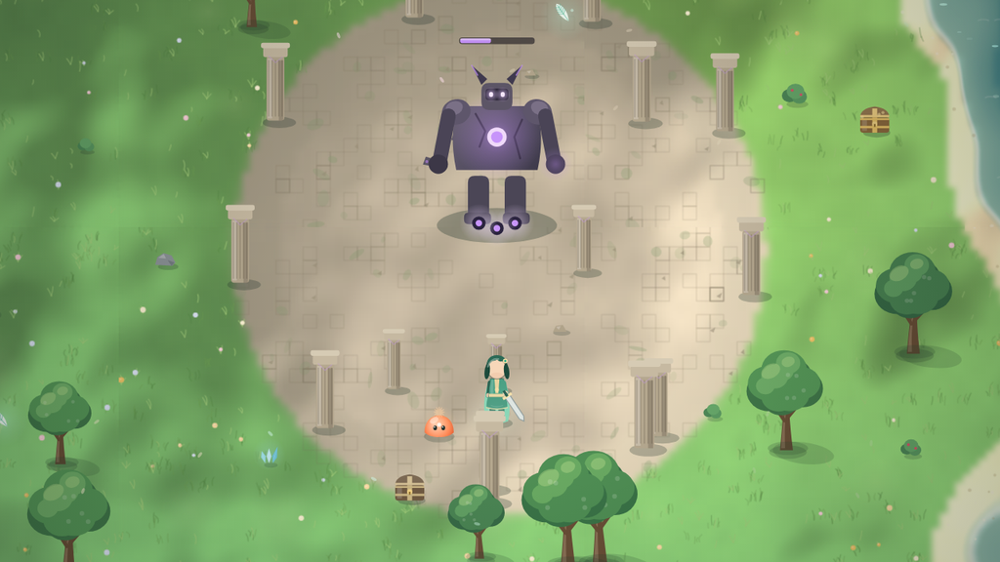
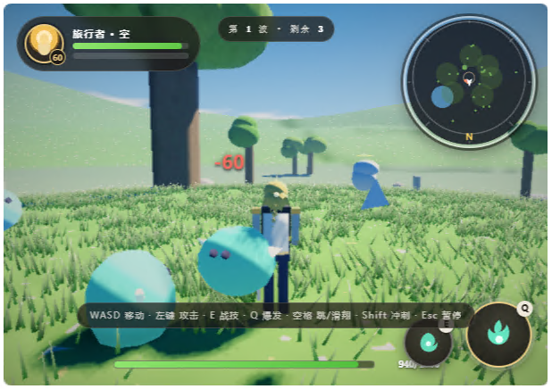
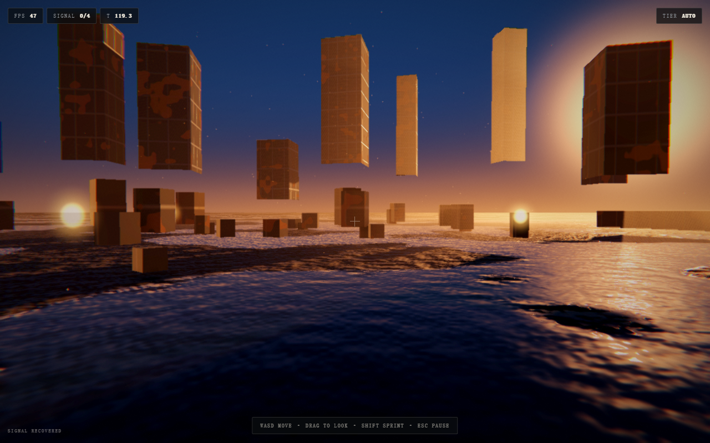

# Single-File Game

**브라우저 게임을 HTML 파일 하나로 완성합니다. 기본은 3D, AAA급 비주얼. 에셋 없음, 빌드 없음, 실행 중 네트워크 없음.**

[](https://github.com/mollyneko/single-file-game/actions/workflows/validate.yml)
[](LICENSE)

[English](README.md) · [简体中文](README.zh-CN.md) · [日本語](README.ja.md) · **한국어**

---

## 무엇인가

**에이전트 스킬**입니다(표준 `SKILL.md` 형식, 참고 문서·스크립트·실행 가능한 템플릿 포함).
다루는 주제는 하나입니다 — 게임을 **자기완결적인 HTML 파일 하나**로 출시하는 일.

플레이어가 보고 듣는 모든 것은 브라우저 안의 코드가 그 자리에서 생성합니다. 그림은 canvas나
셰이더로 그리고, 소리는 WebAudio로 합성하며, 맵과 레벨은 시드와 표로 조립합니다. 파일은 더블클릭으로
열리고, 오프라인에서도 동작하며, CDN이나 번들러, 다른 누군가의 서버 가동률에 의존하지 않습니다.

"게임 만드는 법"을 설명하는 튜토리얼이 아닙니다. 실제 단일 파일 게임에서 뽑아내어 정말로 효과가 있는
부분만 남긴 **실행 가능한 방법**과, 그 방법을 강제하는 도구 모음입니다.

**기본 산출물은 3D입니다.** 2D는 요청할 때만 선택하는 노선이지, 기본 대안이 아닙니다.

| 2D — 선택 노선, 완성된 게임 | 3D — 기본 노선, 완성된 게임 |
| --- | --- |
|  |  |
| Canvas 2D · 189 KB · 3840×3840 세계, 4인 파티, 원소 반응, 퀘스트 | WebGL2 · 140 KB · 오픈 필드, HDR, 소프트 섀도, 볼류메트릭 |

둘 다 같은 규칙으로 완성한 게임입니다. 각각 단일 파일이고, 지형과 캐릭터와 소품이 모두 실행 중에
생성되며 디스크에 텍스처가 없습니다. 두 프레임 모두 네트워크를 끈 상태에서 `file://`로 실행했고,
안에 이미지 파일은 하나도 없습니다. 왼쪽은 canvas 호출만으로 그린 세계, 오른쪽은 직접 작성한 포스트
체인을 가진 실시간 WebGL2 렌더링입니다.

### 여섯 축으로 평가한다

**공간·빛·재질·반사·세계의 디테일·예산.** 카메라는 장면 안에 있고, 태양은 하나이며 그림자는 실제로
계산되고, 재질에는 마모와 이음매가 있고, 반사는 지평선과 일치하며, 표면에는 아무도 읽지 않을 정보가
얹혀 있고, 바이트는 엔진 재구현이 아니라 에셋에 쓰입니다. 여섯 중 셋을 놓치면 기능 목록이 아무리
길어도 그것은 프로토타입입니다. 각 축의 합격선과 수치, 그리고 이 기준이 없을 때 생기는 문제는
[`SKILL.md`](SKILL.md#1-why-a-frame-reads-as-aaa-six-axes)에 있습니다.

## 단일 파일은 '프로토타입 화질'의 변명이 아니다

단일 파일은 제약이지, 회색 상자를 내놓을 이유가 아닙니다. 3D 템플릿은 작은 시네마틱 렌더러를
하나의 `<script>` 안에 처음부터 끝까지 직접 작성한 참조 구현입니다.

```
섀도 맵 → HDR 씬(PBR 하늘·지면·오브젝트) → 볼류메트릭 광선
        → SSAO + 양방향 블러 → Bloom 피라미드 → ACES + 그레이딩
        → sRGB 인코딩 → FXAA + 그레인
```

> 템플릿은 일부러 렌더러를 직접 작성했습니다. 75 KB로 모든 패스를 한 번에 볼 수 있는 대신
> 크래프트 게이트는 `2/4`입니다. 이것은 참조 슬라이스일 뿐 모델링 경로가 아닙니다. 출시할
> 3D 게임은 **three.js 인라인 필수**, **모든 모델을 저장소에 수록한
> [img2threejs](https://github.com/img2threejs/img2threejs) 파이프라인으로 생성 필수**
> (`img2threejs/PIPELINE.md`). 두 규칙 모두 감사기가 확인합니다.

무엇을 얻는가:

- **태양 하나, 하늘 함수 하나.** 돔, 환경광, 안개색, 물웅덩이 반사가 모두 같은 `skyColor()`를
  호출하므로 보이는 지평선과 물에 비친 지평선이 반드시 일치합니다.
- **스케일이 있는 표면.** 재질마다 다섯 채널(알베도, 거칠기, 금속도, 높이, AO)에 프라이머 → 녹 순서의
  마모, 오브젝트 공간의 판 이음새, 어두워지고 평평해지고 거울이 되는 습윤 마스크.
- **대기.** 절반 해상도 레이마칭, Henyey-Greenstein 위상 함수, 높이 밀도, 단계별 그림자 조회.
  "3D"와 "장소"의 차이가 여기서 납니다.
- **필터가 아닌 그레이딩.** ACES, 냉온 분리, 비네트, 1.2% 그레인. 순서대로 적용하고 마지막에 한 번만
  인코딩합니다.

수치와 실패 모드는 [`references/cinematic-look.md`](references/cinematic-look.md)와
[`references/material-authoring.md`](references/material-authoring.md)에 있습니다.

템플릿은 직접 코드를 한 줄도 쓰기 전부터 이 화면을 보여줍니다:



## 네 가지 규칙

각 규칙은 실패 유형 하나를 통째로 제거합니다.

| 규칙 | 의미 | 없어지는 문제 |
| --- | --- | --- |
| **파일 하나** | `<style>` 하나, `<script>` 하나, 외부 `src`/`href` 없음 | 파일 누락, CDN 장애 |
| **에셋 0** | 그림은 그리기, 소리는 합성, 텍스처는 굽기 | 404, 라이선스, "에셋 미포함" |
| **빌드 없음** | 순수 ES를 그대로 열기 | 툴체인 표류, "내 PC에서는 되는데" |
| **네트워크 없음** | 실행 중 원격 요청 없음 | 오프라인 실패, 프라이버시 문제 |

## 빠른 시작

```bash
git clone git@github.com:mollyneko/single-file-game.git
cd single-file-game

# 1. 이미 플레이 가능한 게임 생성 (부팅·플레이·일시정지·저장 동작)
python scripts/scaffold.py --name "Orb Runner" --mode 2d --out orb-runner.html

# 2. GAME 블록을 교체하고 감사 실행
python scripts/check_single_file.py orb-runner.html --strict
python scripts/check_single_file.py night-shift.html --strict --craft   # 3D

# 3. 열기 — 더블클릭 또는:
open orb-runner.html        # macOS
start orb-runner.html       # Windows
xdg-open orb-runner.html    # Linux
```

`--mode 3d`를 주면 WebGL2 경로가 됩니다. 두 템플릿 모두 완성된 껍데기입니다. 디자인 토큰, 부팅 화면,
타이틀, HUD, 일시정지·결과 카드, 입력 레이어, 오디오 버스, 저장 버스, 에러 경계, 적응형 화질, 그리고
직접 규칙을 넣을 전용 블록까지 들어 있습니다.

## 스킬로 설치

**Claude Code / 플러그인 마켓플레이스**

```bash
/plugin marketplace add mollyneko/single-file-game
/plugin install single-file-game
```

**수동 설치 (`SKILL.md`를 읽을 수 있는 어떤 에이전트든)**

```bash
git clone git@github.com:mollyneko/single-file-game.git
cp -r single-file-game ~/.claude/skills/single-file-game      # Claude Code
cp -r single-file-game ~/.workbuddy/skills/single-file-game   # WorkBuddy
```

저장소 루트가 곧 스킬 본체입니다 — `SKILL.md` + `references/` + `scripts/` + `assets/`.

## 구성

```
single-file-game/
├── SKILL.md                    방법: 규칙, 절차, 색인, 안티패턴
├── references/
│   ├── architecture.md         파일 구조, 씬 머신, 루프 계약, 리사이즈와 DPR
│   ├── procedural-art-2d.md    시드 팔레트, 도형 기본기, 타일 굽기, 이펙트
│   ├── procedural-3d.md        three.js 인라인, 생성 텍스처, 그레이딩, 화질 단계
│   ├── cinematic-look.md       렌더 스택: 태양, 하늘, 그림자, 볼류메트릭, Bloom, 그레이드
│   ├── asset-craft.md          크래프트 게이트 근거: 티어다운 증거, --craft 신호 그룹
│   ├── material-authoring.md   PBR 채널, 마모, 이음새, 트라이플래너, 물, 베이크
│   ├── game-feel.md            히트스톱, 흔들림, 이징, 파티클, 오디오 레이어, HUD 모션
│   ├── procedural-audio.md     SFX 버스, 노이즈, 스텝 시퀀서 음악, 믹싱
│   ├── input-and-mobile.md     단일 입력 의도, 터치 스틱, 포인터 락, 세이프 에어리어
│   ├── state-and-persistence.md 저장 구조, 버전, 마이그레이션, 자동 저장
│   ├── performance.md          프레임 예산, 굽기, 풀링, 적응형 화질
│   ├── resilience-and-a11y.md  에러 경계, 단계적 축소, 모션 감소
│   ├── design-language.md      토큰, 타입 스케일, 버튼, HUD 구성
│   ├── visual-self-review.md   촬영 → 채점 → 수정 → 재촬영 루프, 리그 체크리스트
│   └── release-checklist.md    출시 전 체크리스트
├── img2threejs/                수록한 모델링 파이프라인(Apache-2.0): 참조 이미지 →
│   │                           리그 붙은 THREE.Group 팩토리. 진입점은 PIPELINE.md
│   └── …                      forge/ 단계, grimoire/ 규칙, docs/, 자체 LICENSE
├── assets/
│   ├── starter-2d.html         바로 실행되는 Canvas 게임 껍데기
│   └── starter-3d.html         순수 WebGL2 포스트체인 참조 슬라이스(껍데기이지 경로가 아님)
├── scripts/
│   ├── scaffold.py             템플릿에서 이름 있는 게임 생성
│   └── check_single_file.py    규칙에 비추어 파일 감사
├── docs/
│   └── method.md               왜 이런 제약인지, 언제 쓰지 말아야 하는지
├── THIRD_PARTY.md              수록한 파이프라인의 출처와 라이선스
└── tests/                      두 도구의 단위 테스트
```

## 7단계 방법

1. **한 문장으로 범위를 정한다.** 루프 하나, 주 동작 하나, 실패 상태 하나, 재시작 하나.
2. **껍데기를 먼저 만든다.** 토큰 → 부팅 → 타이틀 → 캔버스 → HUD → 화면들 → 에러 경계.
3. **의존 순서로 시스템을 얹는다.** 루프와 리사이즈가 먼저, 입력이 다음, 게임플레이가 마지막.
4. **한 컷처럼 조명한다.** 구도, 키 라이트 하나, 마모가 있는 재질, 대기, 그다음 후처리 체인.
   노출을 만지기 전에 sRGB 인코딩을 확인한다.
5. **콘텐츠는 데이터로.** 손으로 쓴 인스턴스가 아니라 표와 시드 생성기.
6. **손맛은 의도적으로 설계한다.** 흔들림, 파티클, 팝, 클릭음, 대기 모션 — 모두 저렴하고 모두 점검 항목.
7. **스스로 보고, 고치고, 다시 찍고, 감사한다.** 캐릭터 확대 컷을 포함해 실제 스크린샷을
   2라운드 이상 찍고 9개 축을 문서로 채점한다. 그다음 `check_single_file.py --strict --craft`
   (에셋 크래프트 **와** 세 가지 하드 제약)와 릴리스 체크리스트를 통과시킨다.

근거는 [`docs/method.md`](docs/method.md), 실무 디테일은 [`SKILL.md`](SKILL.md)에 있습니다.

## 도구

| 명령 | 역할 |
| --- | --- |
| `python scripts/scaffold.py --name "X" --mode 2d\|3d --out X.html` | 템플릿을 복사하고 제목·부팅 표기·저장 네임스페이스·강조색을 설정 |
| `python scripts/check_single_file.py X.html --strict` | 원격 리소스, 네트워크 호출, 빠진 껍데기, 존재하지 않는 요소 ID, 과대 용량이면 실패 |
| `python scripts/check_single_file.py X.html --strict --craft` | 3D 출하 게이트: 형상 가공·재질 라이브러리·생성 텍스처·스키닝 누락, **그리고** SSAO·깊이 인식 볼류메트릭·프리룩 마우스·`SELF-REVIEW` 기록 누락 시 실패(각 게이트 `4/4`) |
| `python -m unittest discover -s tests -v` | 감사기와 스캐폴드를 정상/비정상 파일로 검증 |

도구 모음의 핵심은 감사기입니다. 이 형식이 저지르기 쉬운 실수를 정확히 겨냥합니다. "일단" 추가한
`<script src>`, 지우지 않은 `fetch`, HTML만 고치고 JS에 남겨 둔 요소 ID, 어느새 3 MB가 된 파일.

```
FAIL  game.html  (1284.6 KB)
  x  <script src> found at line 12 — the file must work offline
  x  referenced but missing ids: hud-score, btn-retry
  !  no prefers-reduced-motion handling
```

## 쓰지 말아야 할 때

경계는 솔직하게 긋습니다. 실시간 동기화 멀티플레이, 대량의 수작업 아트나 음악 라이브러리, 장기적인
팀 개발과 파일 단위 리뷰, 레벨별 딥링크나 A/B 테스트가 필요하다면 일반적인 빌드와 에셋 파이프라인을
쓰세요.

프로토타입, 데모, 게임 잼, 교육, 사내 도구, 작은 제품에서는 파일 하나가 타협이 아닙니다. 아이디어에서
플레이어까지의 가장 짧은 길입니다.

## 감사의 말

3D 모델은 모두 수록한 [img2threejs](https://github.com/img2threejs/img2threejs)(Apache-2.0, [`THIRD_PARTY.md`](THIRD_PARTY.md) 참조)가 만들며, 저자분들께 감사드립니다.

## 라이선스

MIT © [mollyneko](https://github.com/mollyneko)
