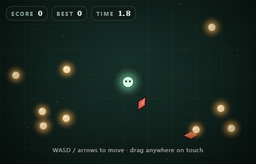
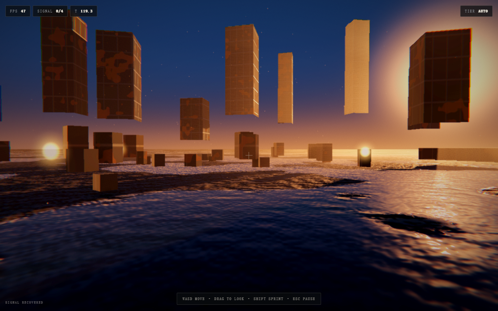

# Single-File Game

**Build a complete, playable browser game as one HTML file. No assets, no build step, no network at runtime.**

[](https://github.com/mollyneko/single-file-game/actions/workflows/validate.yml)
[](LICENSE)

**English** · [简体中文](README.zh-CN.md) · [日本語](README.ja.md) · [한국어](README.ko.md)

---

## What this is

An **agent skill** (standard `SKILL.md` format, with references, scripts and runnable
templates) that captures one specific craft: shipping a game as a **single self-contained
HTML file**.

Everything the player sees and hears is generated by code in the browser — art drawn with
canvas or shaders, audio synthesized with WebAudio, maps and levels built from seeds and
tables. The file opens by double-clicking, works offline, and has no dependency on a CDN, a
bundler, or anyone else's uptime.

It is not a tutorial about "making games". It is a working method plus the tooling that
enforces it, extracted from real single-file games and reduced to what actually matters.

| 2D starter | 3D starter |
| --- | --- |
|  |  |
| Canvas 2D · 28 KB · collect, dodge, score, save | WebGL2 · 27 KB · instanced geometry, post-process grade |

Both screenshots are the actual templates in `assets/`, running from `file://` with the
network off.

## The four rules

Every rule removes a whole category of failure.

| Rule | Means | Removes |
| --- | --- | --- |
| **One file** | one `<style>`, one `<script>`, no `src`/`href` to anything | missing files, broken CDNs |
| **Zero assets** | art drawn, audio synthesized, textures baked | 404s, licensing surface, "assets not included" |
| **No build** | plain ES, opened directly | toolchain drift, "works on my machine" |
| **No network** | nothing remote at runtime | offline failure, privacy questions |

## Quick start

```bash
git clone git@github.com:mollyneko/single-file-game.git
cd single-file-game

# 1. generate a playable game (it already boots, plays, pauses, saves)
python scripts/scaffold.py --name "Orb Runner" --mode 2d --out orb-runner.html

# 2. replace the GAME block, then audit the result
python scripts/check_single_file.py orb-runner.html --strict

# 3. open it — double-click, or:
open orb-runner.html        # macOS
start orb-runner.html       # Windows
xdg-open orb-runner.html    # Linux
```

`--mode 3d` gives you the WebGL2 path instead. Both templates are complete shells: design
tokens, boot screen, title, HUD, pause and game-over cards, input layer, audio bus, save bus,
error boundary, adaptive quality and a marked block where your rules go.

## Install as a skill

**Claude Code / plugin marketplace**

```bash
/plugin marketplace add mollyneko/single-file-game
/plugin install single-file-game
```

**Manual (any agent that reads `SKILL.md`)**

```bash
git clone git@github.com:mollyneko/single-file-game.git
cp -r single-file-game ~/.claude/skills/single-file-game      # Claude Code
cp -r single-file-game ~/.workbuddy/skills/single-file-game   # WorkBuddy
```

The skill is the repository root: `SKILL.md` plus `references/`, `scripts/`, `assets/`.

## What's inside

```
single-file-game/
├── SKILL.md                    the method: rules, workflow, reference index, anti-patterns
├── references/
│   ├── architecture.md         file layout, scene machine, loop contract, resize/DPR
│   ├── procedural-art-2d.md    seeded palettes, shape primitives, tile baking, effects
│   ├── procedural-3d.md        WebGL2 setup, generated textures, grade, quality tiers
│   ├── procedural-audio.md     SFX bus, noise, step-sequenced music, mixing
│   ├── input-and-mobile.md     one intent object, touch sticks, pointer lock, safe areas
│   ├── state-and-persistence.md  save shape, versioning, migration, autosave
│   ├── performance.md          frame budget, baking, pooling, adaptive quality
│   ├── resilience-and-a11y.md  error boundary, degradation ladder, reduced motion
│   ├── design-language.md      tokens, type scale, buttons, HUD composition
│   └── release-checklist.md    the ship gate
├── assets/
│   ├── starter-2d.html         runnable canvas game shell
│   └── starter-3d.html         runnable WebGL2 game shell
├── scripts/
│   ├── scaffold.py             generate a named game from a template
│   └── check_single_file.py    audit a file against the format rules
├── docs/
│   └── method.md               why the constraints exist, and when not to use them
└── tests/                      unit tests for both tools
```

## The method in six steps

1. **Scope in one sentence.** One loop, one primary verb, one failure state, one restart.
2. **Build the shell.** Tokens → boot → title → canvas → HUD → screens → error boundary.
3. **Systems in dependency order.** Loop and resize first; input second; gameplay last.
4. **Content as data.** Tables plus a seeded generator, not hand-authored instances.
5. **Feel on purpose.** Shake, particles, pops, ticks, idle motion — all cheap, all checked.
6. **Audit.** `check_single_file.py --strict`, then walk the release checklist.

Full reasoning in [`docs/method.md`](docs/method.md); operational detail in
[`SKILL.md`](SKILL.md).

## Tools

| Command | What it does |
| --- | --- |
| `python scripts/scaffold.py --name "X" --mode 2d\|3d --out X.html` | Copies a template, sets the title, boot mark, save namespace and accent colour |
| `python scripts/check_single_file.py X.html --strict` | Fails on remote resources, network calls, missing shell parts, dangling element IDs, oversized files |
| `python -m unittest discover -s tests -v` | Tests the auditor and the scaffolder against known-good and known-bad files |

The auditor is the point of the toolchain. It catches the mistakes that this format makes
easy: a `<script src>` added "just for now", a `fetch` left in, an element ID renamed in the
markup but not in the code, a 3 MB file that nobody noticed growing.

```
FAIL  game.html  (1284.6 KB)
  x  <script src> found at line 12 — the file must work offline
  x  referenced but missing ids: hud-score, btn-retry
  !  no prefers-reduced-motion handling
```

## When not to use this

Be honest about the boundary. Use a normal build and an asset pipeline when you need
real-time multiplayer sync, large hand-made art or audio libraries, long-lived team
development with file-level review, or per-level deep links and A/B testing.

For prototypes, demos, game jams, teaching, internal tools and small products, one file is
not a compromise — it is the shortest path between an idea and a player.

## License

MIT © [mollyneko](https://github.com/mollyneko)
