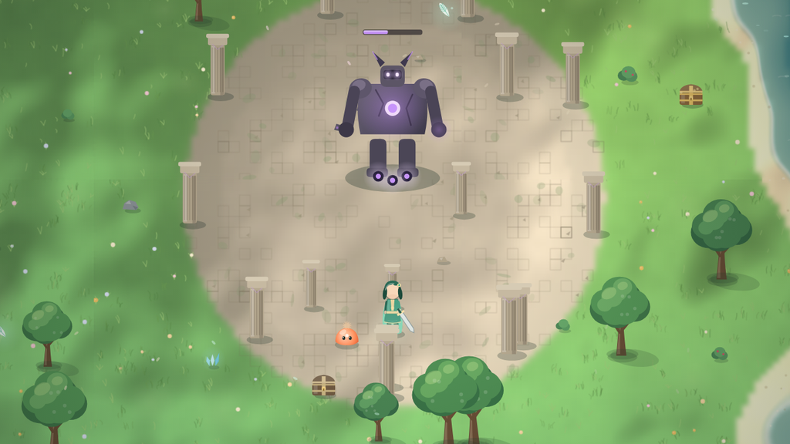
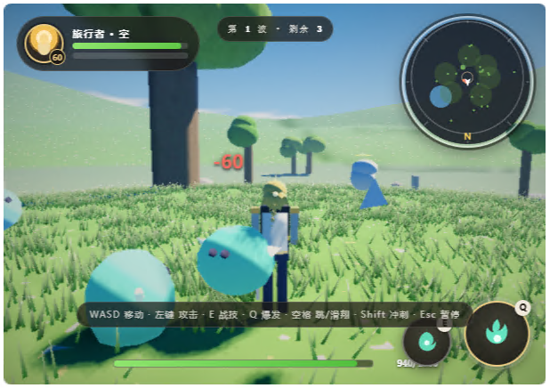
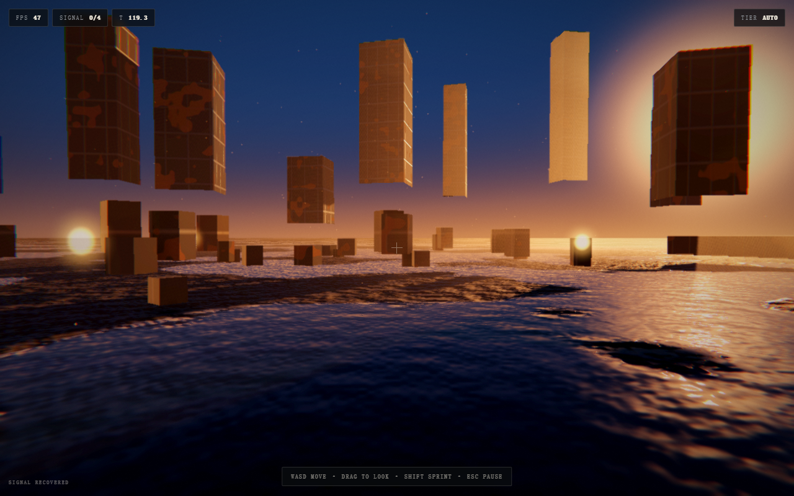

# Single-File Game

**用一个 HTML 文件做出完整、可玩的浏览器游戏。默认 3D、3A 级观感。零素材、零构建、运行时零网络。**

[](https://github.com/mollyneko/single-file-game/actions/workflows/validate.yml)
[](LICENSE)

[English](README.md) · **简体中文** · [日本語](README.ja.md) · [한국어](README.ko.md)

---

## 这是什么

一个**智能体技能包**（标准 `SKILL.md` 格式，带参考资料、脚本与可直接运行的模板），只专注一件事：
把游戏交付成**一个自包含的 HTML 文件**。

玩家看到和听到的一切都由浏览器里的代码现场生成——美术用 canvas 或着色器绘制，音效用 WebAudio
合成，地图与关卡由种子和表格生成。文件双击即开、断网可用，不依赖 CDN、打包器或任何第三方的可用性。

这不是"如何做游戏"的教程。它是一套可执行的方法，加上强制这套方法的工具链，从真实的单文件游戏中
提炼，只保留真正起作用的部分。

**默认交付 3D。** 2D 是需要明确提出才走的路线，不是默认退路。

| 2D —— 可选路线，一个完整游戏 | 3D —— 默认路线，一个完整游戏 |
| --- | --- |
|  |  |
| Canvas 2D · 189 KB · 3840×3840 世界、四人小队、元素反应、任务链 | WebGL2 · 140 KB · 开放地形、HDR、软阴影、体积光 |

两张都是照同一套规则做出来的完整游戏：各自单文件，地形、角色、道具全在运行时生成，磁盘上没有
贴图。两张都在断网状态下用 `file://` 直接运行，画面里没有一个图片文件——左图的世界完全由 canvas
调用画出，右图是带手写后处理链的实时 WebGL2 渲染。

### 按六个维度评判

**空间、光照、材质、反射、世界细节、性能预算。** 相机在场景内部、一个太阳带真实阴影、材质带磨损与
接缝、反射与地平线一致、表面带着没人会去读的信息、字节花在资产上而不是重写引擎。六条里缺三条，
无论功能列表多长都还是原型。每条的下限、数字与它防止的具体失败：
[`SKILL.md`](SKILL.md#1-why-a-frame-reads-as-aaa-six-axes)。

## 单文件不等于原型画质

单文件是约束，不是交出灰色方块的理由。3D 模板就是一套从零手写的小型电影级渲染管线的参考实现，
全部装在一个 `<script>` 里：

```
阴影贴图  →  HDR 场景（PBR 天空 + 地面 + 物体）  →  体积光（God rays）
        →  SSAO + 双边模糊  →  Bloom 金字塔  →  ACES + 调色
        →  sRGB 编码  →  FXAA + 胶片颗粒
```

> 模板是故意手写渲染器的——75 KB 里能一次看完全部 pass，代价是工艺门禁只有 `2/4`。
> 真正要交付的 3D 游戏不该这么花预算：先内联引擎，再把字节花到资产上
> （[`references/asset-craft.md`](references/asset-craft.md)）。

具体换来什么：

- **一个太阳、一个天空函数。** 穹顶、环境补光、雾色、水洼反射都调用同一个 `skyColor()`，所以你看
  到的地平线和水里倒映的地平线必然一致。
- **有尺度的表面。** 每个材质五个通道——反照率、粗糙度、金属度、高度、AO——加上底漆→锈蚀的磨损
  次序、物体空间的钢板接缝，以及会变暗、变平、变镜面的湿润遮罩。
- **大气。** 半分辨率光线步进，带 Henyey-Greenstein 相函数、高度密度和逐步阴影查询。"三维感"和
  "一个地方"的差别就在这里。
- **调色而不是滤镜。** ACES、冷暖分离、暗角、1.2% 颗粒，按顺序做，最后只编码一次。

完整推导、数值与失败模式见 [`references/cinematic-look.md`](references/cinematic-look.md) 与
[`references/material-authoring.md`](references/material-authoring.md)。

模板本身开箱就是这样，你还没写一行自己代码的时候：



## 四条铁律

每一条都消除一整类失败。

| 铁律 | 含义 | 消除的问题 |
| --- | --- | --- |
| **单文件** | 一个 `<style>`、一个 `<script>`，没有任何外部 `src`/`href` | 文件缺失、CDN 挂掉 |
| **零素材** | 美术用画的、音效用合成的、贴图用烘焙的 | 404、授权风险、"素材未包含" |
| **零构建** | 原生 ES，直接打开 | 工具链漂移、"我这能跑" |
| **零网络** | 运行时没有任何远程请求 | 断网失效、隐私疑问 |

## 快速开始

```bash
git clone git@github.com:mollyneko/single-file-game.git
cd single-file-game

# 1. 生成一个已经能玩的游戏（启动、游玩、暂停、存档都已就绪）
python scripts/scaffold.py --name "Orb Runner" --mode 2d --out orb-runner.html

# 2. 替换 GAME 区块，然后审计
python scripts/check_single_file.py orb-runner.html --strict
python scripts/check_single_file.py night-shift.html --strict --craft   # 3D

# 3. 打开它 —— 双击即可，或者：
start orb-runner.html       # Windows
open orb-runner.html        # macOS
xdg-open orb-runner.html    # Linux
```

`--mode 3d` 换成 WebGL2 路线。两个模板都是完整的壳：设计变量、启动屏、标题页、HUD、暂停与结算
卡片、输入层、音频总线、存档总线、错误兜底、自适应画质，以及一块标好的、属于你的规则区。

## 作为技能安装

**Claude Code / 插件市场**

```bash
/plugin marketplace add mollyneko/single-file-game
/plugin install single-file-game
```

**手动安装（任何能读 `SKILL.md` 的智能体）**

```bash
git clone git@github.com:mollyneko/single-file-game.git
cp -r single-file-game ~/.claude/skills/single-file-game      # Claude Code
cp -r single-file-game ~/.workbuddy/skills/single-file-game   # WorkBuddy
```

仓库根目录就是技能本体：`SKILL.md` 加上 `references/`、`scripts/`、`assets/`。

## 目录结构

```
single-file-game/
├── SKILL.md                    方法：规则、流程、索引、反模式
├── references/
│   ├── architecture.md         文件布局、场景机、主循环契约、缩放与 DPR
│   ├── procedural-art-2d.md    种子调色板、图形原语、瓦片烘焙、特效
│   ├── procedural-3d.md        WebGL2 搭建、生成贴图、调色、画质档位
│   ├── cinematic-look.md       渲染栈：太阳、天空、阴影、体积光、Bloom、调色
│   ├── asset-craft.md          3D 交付硬门槛：倒角、材质库、生成贴图、连续蒙皮
│   ├── material-authoring.md   PBR 通道、磨损、接缝、三平面投影、水面、烘焙
│   ├── game-feel.md            顿帧、抖动、缓动、粒子、音频分层、HUD 动效
│   ├── procedural-audio.md     SFX 总线、噪声、步进音乐、混音
│   ├── input-and-mobile.md     统一输入意图、触屏摇杆、指针锁定、安全区
│   ├── state-and-persistence.md 存档结构、版本、迁移、自动保存
│   ├── performance.md          帧预算、烘焙、对象池、自适应画质
│   ├── resilience-and-a11y.md  错误兜底、降级阶梯、减少动效
│   ├── design-language.md      设计变量、字号阶梯、按钮、HUD 构图
│   └── release-checklist.md    发布前检查清单
├── assets/
│   ├── starter-2d.html         可直接运行的 Canvas 游戏壳
│   └── starter-3d.html         可直接运行的 WebGL2 游戏壳
├── scripts/
│   ├── scaffold.py             从模板生成一个具名游戏
│   └── check_single_file.py    按格式规则审计文件
├── docs/
│   └── method.md               为什么有这些约束，以及什么时候不该用
└── tests/                      两个工具的单元测试
```

## 七步方法

1. **一句话定范围。** 一个循环、一个主动作、一个失败状态、一个重开入口。
2. **先搭壳。** 设计变量 → 启动屏 → 标题页 → 画布 → HUD → 各类页面 → 错误兜底。
3. **按依赖顺序写系统。** 先主循环与缩放，再输入，最后才是玩法。
4. **像打光一个镜头那样打光。** 构图、单主光、带磨损的材质、大气，最后才是后期链。先检查 sRGB
   编码，再动曝光。
5. **内容即数据。** 表格加种子生成器，而不是手写一个个实例。
6. **手感要刻意设计。** 抖动、粒子、弹跳、点击音、待机动画——成本很低，全部列成清单。
7. **审计交付。** `check_single_file.py --strict`，3D 再加 `--craft`，然后走发布检查清单。

完整论证见 [`docs/method.md`](docs/method.md)，操作细节见 [`SKILL.md`](SKILL.md)。

## 工具

| 命令 | 作用 |
| --- | --- |
| `python scripts/scaffold.py --name "X" --mode 2d\|3d --out X.html` | 复制模板，写入标题、启动标识、存档命名空间与强调色 |
| `python scripts/check_single_file.py X.html --strict` | 对远程资源、网络调用、缺失的壳部件、悬空元素 ID、超大文件直接判失败 |
| `python scripts/check_single_file.py X.html --strict --craft` | 3D 交付硬门槛：缺几何工艺、具名材质库、生成贴图或连续蒙皮即失败 |
| `python -m unittest discover -s tests -v` | 用已知好/坏文件测试审计器与脚手架 |

审计器是这条工具链的重点。它专门抓这个格式最容易犯的错：为图省事加上的 `<script src>`、忘了删的
`fetch`、改了 HTML 却没改 JS 的元素 ID、悄悄长到 3 MB 的文件。

```
FAIL  game.html  (1284.6 KB)
  x  <script src> found at line 12 — the file must work offline
  x  referenced but missing ids: hud-score, btn-retry
  !  no prefers-reduced-motion handling
```

## 什么时候不该用

诚实地划清边界。需要实时联机同步、大量手工美术或音乐素材、长期多人协作与文件级评审、按关卡深链
接或 A/B 测试时，请用正常的构建流程和素材管线。

而在原型、演示、Game Jam、教学、内部工具与小产品场景里，单文件不是妥协——它是从想法到玩家的最短路径。

## 许可

MIT © [mollyneko](https://github.com/mollyneko)
