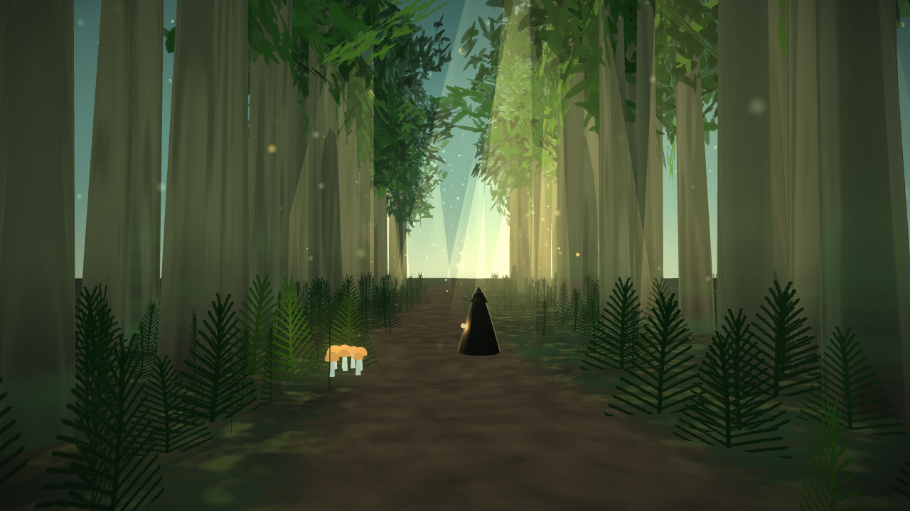
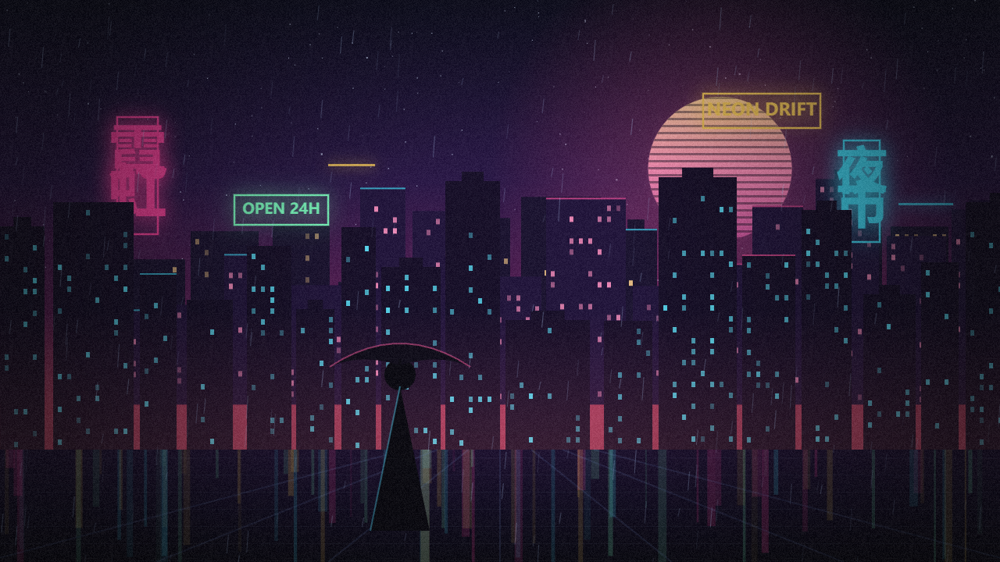

# Single-File Game — 单文件 HTML 游戏

**以你的最高水平制作单文件离线 HTML 游戏——three.js 做骨架、自写着色器填充——再用固定量规与确定性取证证明画面经得起检验。**

[](https://github.com/mollyneko/single-file-game/actions/workflows/validate.yml)
[](LICENSE)

[English](README.md) · **简体中文** · [日本語](README.ja.md) · [한국어](README.ko.md)

<table>
<tr>
<td align="center" width="50%"><b>3D —— 最新版 three.js + 自写着色器</b><br>
</td>
<td align="center" width="50%"><b>2D —— 程序化 canvas，分层烘焙</b><br>
</td>
</tr>
</table>

_代表帧：用最新版内联 three.js + 自写着色器渲染的晨光森林，以及程序化 canvas 夜景。证据单位是帧，不是功能列表。_

---

## 最高强制约束——优先级第一，压过以下所有条款

> 充分发挥你最顶级的审美、艺术设计和3D编程能力，在构图、光影、材质、粒子、动画和空间氛围上做到极致。画面需要有令人震撼的视觉表现力。不限制你的创意和技术方案，尽可能展示你的能力上限。用three.js做骨架+自写着色器填充

这是第一条约束，压过以下所有条款。单文件边界仍然成立：**一个 `.html` 文件，从 `file://` 打开，无服务端、无网络、无外部资源。** 一切内联。

## 这是什么

一个面向单文件 HTML 游戏的「制作 + 验证」Skill。它给你上面的视觉 mandate、一个把"优秀"写成可测量条款的九轴量规、一套让两次评审可比较的固定取证协议，以及检查脚本能查的部分。证据单位是**帧**——不是功能列表、不是代码行数，也不是写满 5 分的 `SELF-REVIEW` 标记。源码永远不是证据：源里骨架正确，画面上照样可能是一只悬空的手。

2.x 版本移除了内置的构建链路（脚手架、内置引擎、起始模板、美术与音频指南）。保留下来的是这份 mandate、下面这份精简制作顺序和验证体系；怎么产出这个文件由你决定。

## 制作流程——把最高约束变成工作流

六个方面不是收尾时才填的清单，而是制作顺序。每一步都必须出现在四张协议帧中的某一张里。

0. **锁外壳与视觉命题。** 单一内联 `.html`，第一版就接好 `?shot=` / `?prewarm=` / `?q=` / `?seed=`，加上错误边界和 DPR/缩放处理。用一句话写清焦点、配色、光向和情绪，后面所有选择都为它服务。
1. **构图**——相机放进场景里，而不是悬在平面上方；三层景深、一个视觉焦点、清晰的价值层级。先把 `title`、`play`、`char-closeup`、`hero-effect` 四张框好，再谈细节。
2. **光影**——一个方向明确的主光；真实阴影、接触 AO / SSAO、深度雾与体积光、统一调色。把同一份太阳、雾和阴影数据喂给自写着色器，让表面响应世界，而不是贴上去的。
3. **材质**——命名材质族，运行时生成 albedo / roughness / metal / height / AO 与磨损缝线；现成材质表达不出的部分交给自写 GLSL。反射和天空要一致。
4. **粒子**——用实例化或 GPU 驱动粒子承载空间信息：光柱里的尘埃、命中飞溅、风、余烬，不是彩纸屑。运动、密度和颜色服从第 2–3 步的光与氛围。
5. **动画**——用连通的骨架或变形器做待机 / 移动 / 命中；程序化运动可以，肢体断开不行。加缓动、顿帧、震动和相机响应；检查动态帧和特写，而不只是静止姿势。
6. **空间氛围**——板件、贴花、碎片和朝玩法区递增的密度；视差与雾让世界延伸到画面之外。Bloom、颗粒、暗角和调色放最后，服务于第 0 步的命题，而不是补救扁平场景。
7. **系统 → 验证循环。** 闭合玩法循环，接好输入 / 暂停 / 重开和容错。3D 交付每个模型保留一条 `PIPELINE-RECEIPT`。然后走下面的六层循环：拍摄 → 评分 → 从最差轴开始修 → 重拍同样的四张图。两轮是底线。

某一步如果在协议帧里看不见，对本 Skill 来说就等于没做。

## 六层——如何验证画面

| # | 层 | 工具 | 失败条件 |
| --- | --- | --- | --- |
| 1 | 格式 | `check_single_file.py … --strict` | 外链、网络请求、缺失 id、缺 `<title>`/viewport、无错误边界 |
| 2 | 工艺（仅 3D） | 同命令加 `--craft` | 无内联 `three.js`、无效 `PIPELINE-RECEIPT`、裸图元、纯 RGB 调色板、无贴图、骨骼无蒙皮 |
| 3 | 硬约束（仅 3D） | 同一轮，加屏幕检查 | 缺 SSAO、缺深度感知体积光、拖拽才能转视角、无自审记录 |
| 4 | 帧指标 | `score_frame.py capture` + `--craft` | manifest/指纹不符、一个画面冒充四张、分数超过该画面设定的 caps |
| 5 | 九轴 | `references/scoring-rubric.md` | 任一轴低于 4 分、六交付轴不足五个达线、肢体断开 |
| 6 | 交付清单 | `references/release-checklist.md` | 脚本看不见的启动、输入、玩法、容错、无障碍、内容与交付缺陷 |

前五层是一个修复循环的输入：拍摄 → 评分 → 修最差的轴 → 重拍 → 再评。第 4 层不分介质：2D canvas 画面和 WebGL 画面一样会死黑、过曝、失色。第 2–3 层对 2D 不存在，评分依然存在。

## 快速开始

```bash
# 1. 机器闸门；--mode 只选体积预算，闸门集合由构建自身决定。
python scripts/check_single_file.py game.html --strict --craft --mode auto

# 2. 固定取证：四张图、1280×720 @1、预热 200 帧、high、seed 0。
python scripts/score_frame.py capture game.html --out review/round-1
python scripts/score_frame.py score review/round-1/manifest.json
python scripts/score_frame.py capture game.html --out review/round-2 --marker

# 3. 对照 references/scoring-rubric.md 书面给九个轴打分，朝最高约束修最差的，
#    重拍同样的帧，最后走一遍 release-checklist.md。
```

构建必须响应 `?shot=title|play|char-closeup|hero-effect`、`?prewarm=`、`?q=` 和 `?seed=`。四张图如果都拍成同一画面，取证被拒绝，判定结果是**无法验证**——不要从源码猜分。`score_frame.py crop shot.png out.png --box x,y,w,h --scale 3` 只是观察手段，永远不是协议帧。需要无头 Chrome、Edge 或 `chrome-headless-shell`（可用 `--chrome PATH` / `CHROME_PATH` 指定）。

## 评分

六个交付轴——空间、光照、材质、反射、世界细节、预算——决定画面是否达到 AAA；三个复审核——美感、结构可信度、UI 可读性——决定画面是否耐看。每轴 1–5 分，**4 分是交付线**；六个交付轴少于五个达线就是原型。2D 通过量规里的翻译表读同一套轴名，门槛不变。像素指标只能降分；超过 cap 的轴必须记录 `overrides`，写明轴名、实测值和风格理由。

`SELF-REVIEW` HTML 注释是把分数和帧绑在一起的收据：

```html
<!-- SELF-REVIEW {"rounds":2,
  "shots":["title","play","char-closeup","hero-effect"],
  "axes":{"space":5,"light":4,"material":5,"reflection":4,"world":4,"budget":4,
          "beauty":4,"structure":5,"ui":5},
  "fixes":["rig: parent-relative bone offsets","added depth-based SSAO"],
  "reshoot":true,
  "metrics":{"manifest":"review/round-2/manifest.json","sha256":"<manifest sha256>"}} -->
```

审计器校验 manifest 哈希、构建指纹、≥3 帧、多于一个视图以及 caps；它不评判数字本身。标记是收据，不是评审。

## 文件

| 路径 | 职责 |
| --- | --- |
| `SKILL.md` | 制作 mandate + 验证入口：最高约束、六面制作流程、六层、协议、判定流程、结论格式 |
| `references/scoring-rubric.md` | 九轴、1–5 档、门槛、2D 翻译表与红线的唯一定义 |
| `references/visual-self-review.md` | 拍 → 评 → 修 → 重拍、肢体检查表、症状 → 原因表 |
| `references/release-checklist.md` | 最后的人工走查 |
| `scripts/score_frame.py` | 取证、像素指标、caps、裁剪 |
| `scripts/check_single_file.py` | 格式、工艺、硬约束、帧指标闸门 |
| `docs/` | 配图：`game-3d.png`（森林，最新版 three.js + 自写着色器）与 `game-2d.png`（程序化 canvas） |
| `tests/` | 回归测试，fixture 全部内联 |

```bash
python -m unittest discover -s tests -v
```

## 许可

MIT，见 [LICENSE](LICENSE)。
